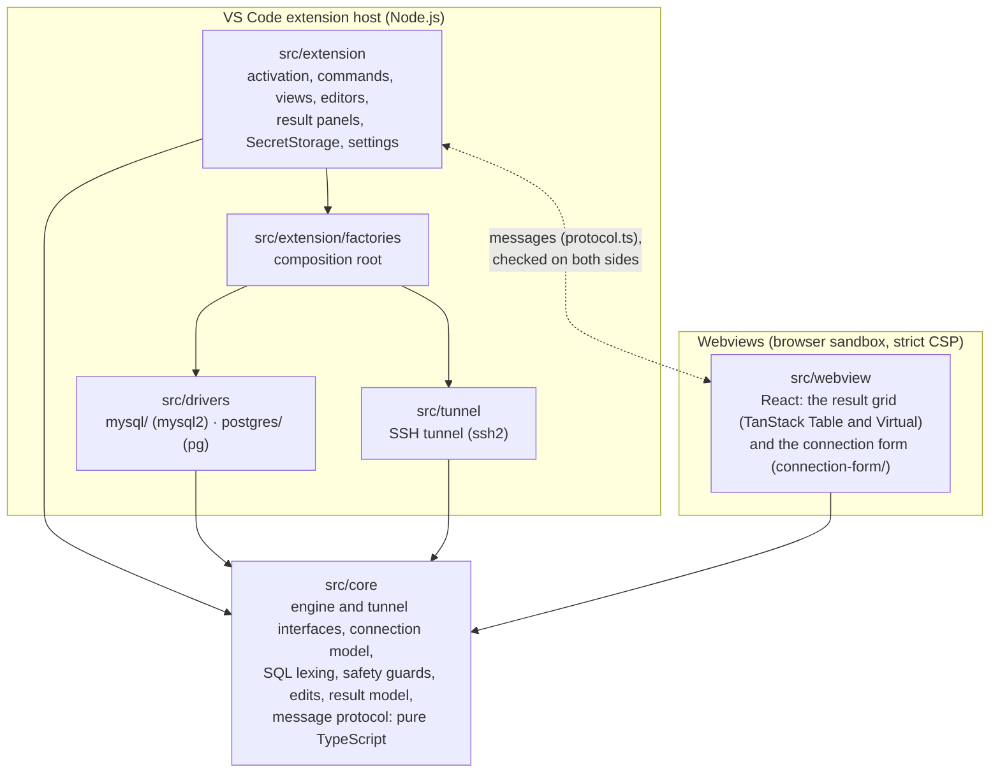
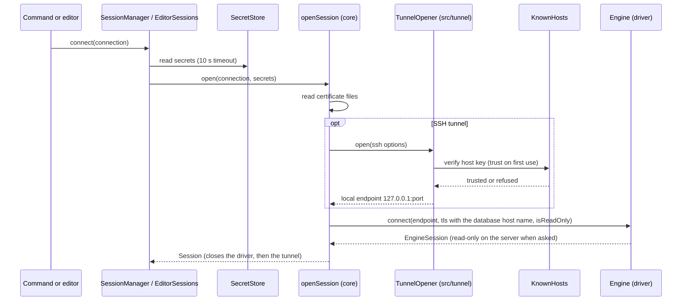
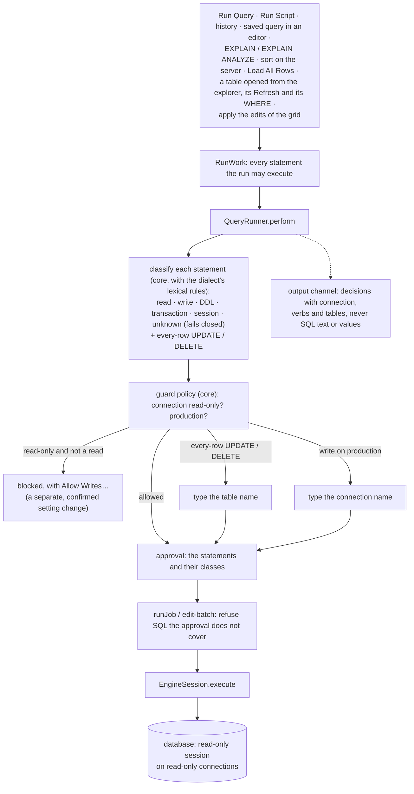
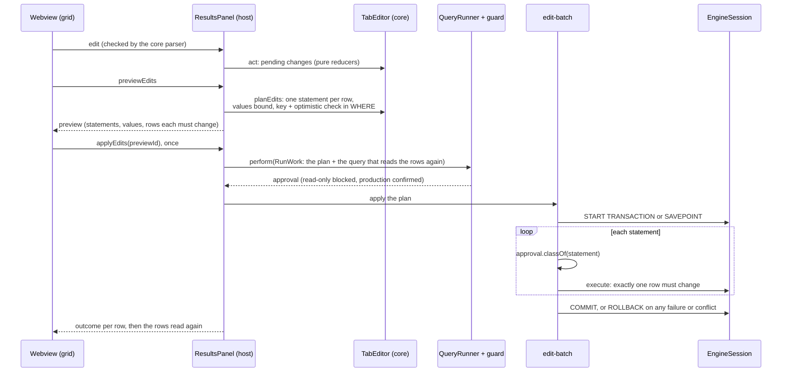
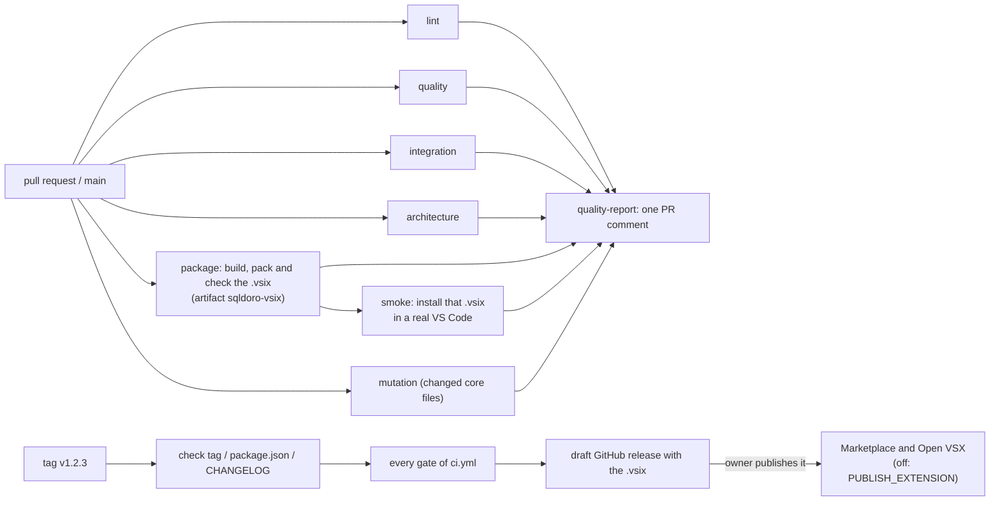

# Architecture

sqldoro is a VS Code extension in strict TypeScript, in five layers with one rule: dependencies point
inward, to the core. The rules below are not conventions only: `make lint-arch` (dependency-cruiser,
`.dependency-cruiser.mjs`) fails on an import that breaks them, `make typecheck` checks the core
without Node.js or DOM types, and `src/extension/safety/guarded-execution.test.ts` fails on any new
place that runs SQL.

## Layers

- **`src/core`** is pure TypeScript: no `vscode`, no Node.js built-ins (it also runs in the webview),
  no database, SSH or UI library. Platform services reach it through interfaces it declares (`Engine`,
  `EngineSession`, `TunnelOpener`, `Logger`, the file reader). Invariants, calculations and state
  transitions live here as pure functions: the statement classifier, the guard policy, the
  automatic `LIMIT`, the transaction state machine, what can be edited and the statements of an
  edit, the result model and the parsers of every message.
- **`src/drivers`** has one folder per database, each implementing `Engine` with its own client
  library only. Drivers never import each other, the tunnel, `vscode`, the extension host or the
  webview.
- **`src/tunnel`** implements the core tunnel interface with `ssh2` and Node.js.
- **`src/extension`** is the VS Code side. It talks to databases only through the core interfaces;
  only `src/extension/factories/` instantiates the drivers and the tunnel, so supporting another
  engine is writing its driver and registering it there (see
  [CONTRIBUTING.md](../CONTRIBUTING.md#adding-a-database-engine)).
- **`src/webview`** holds the two webviews, each a browser bundle of its own (Vite): the result grid
  and the connection form. They never import the extension host. The grid holds no rows of its own
  beyond a bounded cache: the host keeps the rows, and sorts, filters, copies and exports them.

## Opening a session

The driver dials whatever endpoint it is given: it never knows about SSH, and certificates are always
checked against the database host name, also through the tunnel. Errors are redacted of the secrets
the session was opened with before they reach the screen or the log. Each SQL editor runs on its own
session, so a long query never blocks another editor or the explorer; the explorer and the
autocomplete share one session per connection.

## The guard layer

Every statement a user or the grid runs goes through one gate. A run declares every statement it may
execute in a `RunWork`; `QueryRunner.perform` hands them to `StatementGuard`, which decides before
anything runs, and `QueryRunner.runJob` refuses any SQL the guard did not approve.

Only sqldoro's own statements bypass the guard: catalog queries, `START TRANSACTION`, `COMMIT`,
`ROLLBACK`, the savepoints of an apply and the transaction status probe. What the classifier cannot
see (procedures, triggers, user functions) is what the read-only session is for, and the permissions
of the database user remain the real guarantee.

After each statement sqldoro asks the server whether a transaction is open
(`EngineSession.transactionStatus`), so implicit commits, deadlock rollbacks and aborted
transactions show as they are. The automatic `LIMIT` is a pure rewrite in the core that appends
`LIMIT n + 1` only where that is safe, and falls back to a driver row cap elsewhere.

## Editing rows

What can be edited is decided in `src/core/edits/` from what the drivers report (the origin of each
result column, `EngineSession.describeTable`), and fails closed: joins, views, expressions and tables
without a usable key stay read-only, and the grid says why.

## The result view

The extension host runs the statements and keeps their rows (`ResultSet`, in the core). The webview
asks for windows of rows around what is in view (at most 200 at a time, a few thousand cached) and
only shows them; both rows and columns are virtualized, so a million rows or a thousand columns
scroll smoothly. Long values reach the grid cut to 1,000 characters; the detail pane asks for more and
shows up to 200,000. Every message is typed in `src/core/results/protocol.ts` and checked field by
field by the core parsers on the side that receives it. The page has a strict Content Security
Policy: one script with a nonce, styles and images from the extension only, no remote resource; its
icons are inline SVG drawn in the spirit of the codicons, so the page loads no font.

The view only shows what the host decides. Sorting, the filters of the columns and the quick search
are views of the rows the host holds (`ResultSet`): the webview sends the view or the search text, the
host computes the order with pure functions of the core (`applyView`, `searchRows`) and bumps the
view version, and the webview asks for the windows of the new order. The search keeps applying over a
view sorted and filtered on the server, and again once a run brings new rows. The host handles the
messages of the view in `src/extension/results/panel-requests.ts` (the navigation, layout and
catalog requests in `panel-navigation-requests.ts`); the panel itself (`results-panel.ts`) keeps the
tabs of the run and what it posts. The protocol is split by what it describes: the messages in
`protocol.ts`, the editing of a tab in `tab-editing.ts`, what the catalog says of its columns and
rows in `tab-meta.ts`.

The filter of a column is a list of conditions (`src/core/results/conditions.ts`: an operator and its
values, which operators each kind of column takes), all of which a row meets. In the host they match
the rows held with exact comparisons (`filter-match.ts`: numbers compared as decimal text, never as
floating point); on the server they become conditions with bound values (`filter-sql.ts`), each cast
to the type the catalog says the column is compared as (`binders.ts`), with `LIKE` patterns escaped.
The values of a column offered by its filter come from the rows held (`ResultSet.distinct`), at most 500.

The grid shows the columns of the tab's layout (`src/core/grid/column-layout.ts`: the order and the
hidden columns, by column key, so that a layout still fits after a column is added or dropped). The
webview projects the tab, its rows, its view and its editing onto the columns shown and works in them
only (`src/core/grid/column-projection.ts`, `src/webview/projection.ts`); every message it sends is
translated back to the columns of the result before it leaves. Copy and export take the columns
shown, in their order. A table panel keeps its layout per table in the workspace state
(`src/extension/tables/column-layouts.ts`).

While a statement runs, the tab says where it is (`TabProgress`: connecting, running, fetching). The
view never goes blank or flashes in between: what is on screen stays, whole (grid, toolbar, status),
until the next result can replace it in one frame. `tabToShow` (`src/core/grid/shown-tab.ts`) keeps
the tab shown ready last while a new view of it (a refresh, a sort, a filter) or a new run that
replaced it (a navigation in place, a step of the trail) is on its way, and shows the new one once
`isViewReady`: its statement ended, and its first rows are here or it has none to fetch. The rows of
the incoming view are asked for before it shows: by the grid on screen for a new view of its tab, by
the App for the tab of a new run (from where the grid of its step was scrolled); the `RowStore`
keeps the rows of before beside them and each grid reads the rows of its own view version, which
only moves forward. The first result of a panel stays out of sight, in its place, until it is ready
or the wait shows; then only its skeleton (laid out like the grid, which takes its place without
moving it), the rows that stream in and the card show, and its toolbar and status appear once, when
it is ready.

A wait long enough to notice shows: `stepIndicator` (`src/core/grid/loading-indicator.ts`) decides
when, as a pure state machine over the time: nothing for a wait under 300 ms, then a card with the
time waited and Cancel (and the result of before dimmed, or a skeleton before the first rows) that
fades in, stays at least 400 ms and fades out. `WaitIndicator` (`src/webview/wait-indicator.ts`), one
per panel, steps it with timers so that it goes on through a change of tab. Rows the grid does not
hold yet stay blank for 200 ms before their placeholder fades in, and the grid asks for the rows 100
past those in view both ways, so that scrolling does not flash placeholders. Without motion
(`prefers-reduced-motion`) nothing fades, slides or shimmers; the delays stay.

## The explorer and the catalog statistics

The Connections view (`src/extension/tree/`) loads the children of a node when it opens and keeps
them, per connection, until a refresh. `EngineSession.listDatabases` and `listTables` take a
`CatalogDetail`: with `Names` they read the names only (the autocomplete, the pickers, the connection
form); with `Statistics` the same query also reads the size of each database and the estimated rows
and size of each table (`DatabaseStats`, `TableStats` in `src/core/engine/catalog.ts`), one query per
list, never one per object. The values stay exact: the drivers select them as text and the core reads
them as `bigint`; a value the server does not know or the user may not see is `undefined`, never an
error. The explorer asks for the statistics and, if that query fails, lists the names alone and logs
why at debug level, so a missing statistic never breaks a node. The core writes what is shown
(`src/core/engine/catalog-text.ts` and `src/core/text/quantities.ts`: `~27k rows · 32 MB`, sizes
1024-based).

How many tables or views a group holds comes from the list it already loads: the node summarizes its
children while they load, the provider keeps that summary beside the cached children and tells VS Code
to draw the node again. A table or database node knows the node whose list it comes from
(`listedBy`), so refreshing it reads that list again, with its statistics. A list that takes more than
150 ms shows a node that says what loads.

Connections can sit in folders (`clients/acme`, `src/core/connection/folders.ts`): the view shows the
folders as nodes, and renaming or deleting a folder only moves the connections in it. A connection
has a color, which tints its label, the badge of its editors and the chip of its panels (production
is red whatever it is).

Each kind of node has its codicon and a theme color (`NodeIcon` in `src/extension/tree/node-icons.ts`,
the one table of the looks): only theme colors (`charts.*`, `symbolIcon.*`), which have values for
the light, dark and high-contrast themes. A connection shows the glyph of its engine
(`media/explorer/<engine>-<connected|disconnected>-<light|dark>.svg`, drawn for sqldoro), with a green
dot once connected; an engine without a glyph, a connection that connects or failed, show a codicon.
SVG icons cannot take theme colors, so the color of a connection goes to its label: connections,
databases and schemas carry a `resourceUri` (`sqldoro-explorer:`, `node-uris.ts`) and
`ExplorerDecorations` colors their labels through VS Code's file decorations.

The database (and schema) the SQL editor in front runs on stands out: `selectedScopes` and
`changedScopes` (`src/core/editor/selection.ts`, pure) decide what each connection marks (the binding of
the editor in front; with none in front, the default database of each connection) and which marks
moved. `DatabaseSelection` follows the editor in front, its binding and the connections, and tells
which marks changed: the decorations fire for their URIs only (the green label and the `●`), and the
provider draws again only the database and schema nodes it drew whose mark changed (their icon and
tooltip), keeping their children. These redraws do not reach `onDidChangeContents`, the event the
schema cache follows, so moving between editors never reads the catalog again. Finding a table (`TableIndex`, `find-nodes.ts`) lists the tables and views of
the connected connections through the schema cache and shows the matches as a tree of its own,
opened down to them, under ids of their own so that VS Code gives the tree back as it was.

## Table data

A table or view opened from the explorer is a source of results like a SQL editor, keyed by a URI of
its own instead of a document URI: `sqldoro-table:` with the connection, the database, the schema
and the table (`src/extension/tables/table-uri.ts`). The same key finds its result panel, its
database session and its transaction, so opening the table again shows the panel it has, and closing
the panel gives the session back; disconnecting or deleting the connection closes it. Its binding
comes from the URI and its transaction mode is always auto-commit. The core builds its statement
(`tableDataQuery`, with the quoting of the dialect), and it runs through `QueryRunner.perform` like
any other run, so the guards, the automatic limit and the editing of rows apply unchanged. The panel
is titled after the connection as it is named now (`src/extension/results/source-title.ts`).

Its **WHERE** is a condition the user writes, like SQL in an editor, and the only text sqldoro puts
into a statement around it: `tableFilterQuery` builds `SELECT * FROM <table> WHERE (<condition>`, a
line break, then `)`, so that a `--` comment at its end cannot hide the parenthesis. It refuses,
before anything runs, a condition whose strings or comments do not end, one that holds only comments,
one whose parentheses close outside it, and anything that makes the statement more than one (read
with the statement splitter of the guards, so a `;` inside a MySQL executable comment counts). The
statement then goes through `QueryRunner.perform` (`src/extension/tables/table-read.ts`): the
classifier sees the condition with the rest, so a function with effects makes it a write that a
read-only connection refuses. The tab keeps its view (a view on the server wraps the new statement),
gets the automatic limit again, and its Refresh, Load All Rows and server view all read with the
condition; the editability analysis already accepts a `WHERE` after the table, and still fails
closed for anything else. These reads stay out of the query history.

A table panel reads the step of its trail it shows (`src/extension/tables/table-read.ts`): the core
writes the statement (`src/core/results/table-query.ts`) with the key of the step and the filters of
its view as bound values and the WHERE as typed, and it runs through `QueryRunner.perform` like any
run; a change the guards refuse leaves the step as it was. Its sort and filters always run on the
server. **Open in SQL Editor** writes the same statement with the values written in
(`literalBinder`) and the columns shown, in a new editor on the panel's connection, where it runs
through the guards like anything typed. The WHERE colors its SQL and completes it with pure functions
of the core (`src/core/sql/highlight.ts`, `src/core/completion/where-completion.ts`); the host tells
the view how the SQL of the connection is written (the `sql` message: its quote, lexical rules and
keywords).

## Navigation between rows

What a result links to comes from the catalog, never from the text of the query: the drivers trace
each result column back to its table, `EngineSession.listForeignKeys` and `listReferences` give the
foreign keys of a table and those that point at it, and `describeTableAt` describes a table by where
it is. `TableMetadata` (`src/extension/metadata/`) reads them on the session of the explorer and keeps
them with the schema cache, so a refresh of the explorer reads them again. The core turns them into
the links of a result (`src/core/navigation/links.ts`: a foreign key whose columns the result holds
whole, composite ones too; a `NULL` points nowhere) and into the key a navigation reads
(`keys.ts`: one condition per column, every value bound with the cast of its column).

A navigation from a row opens the rows it leads to in a panel of their own, or, in a table panel, in
place: each table panel keeps a trail of steps (`src/core/navigation/history.ts`, held by
`TableNavigations`), each with its WHERE, its view and the row it was left from, which the view shows
as breadcrumbs and goes along with back and forward; a panel that shows the same rows already is
shown again. A peek at the row a link points at and the counts of the rows that reference a row are
reads whose rows stay in the host: they go through the guards (`readThroughGuards`,
`runApprovedRead`, which refuses anything the classifier does not call a read) on the session of the
panel, and a peek is kept per panel.

## The connection form

**Add Connection**, **Import Connection from URL** and **Edit Connection** open the connection form,
a second webview with its own bundle and the same page and policy (`src/extension/webview-page.ts`).
Its message protocol is declared in the core (`src/core/connection-form/protocol.ts`) and checked on
both sides. The form keeps its state with pure functions of the core (`src/core/connection-form/`:
the state and its changes, the problems and where they show, the requests to the host, the engine
picker and the import of a connection string, the database listing; the changes of a connection in
`src/core/connection/transitions.ts`) and validates with the same validators as the host, which
checks the connection again before it tests it, saves it or lists its databases. Secrets never
travel to the form: it learns which kinds are held (stored, or from an imported URL), and what the
user types reaches the host only inside a test, a save, a listing of databases or an import. The host
reads a connection string with the same parser as ever (`src/core/connection/url.ts`) and keeps its
password until the connection is saved; a form that reloads forgets it. Listing the databases is one
of sqldoro's own catalog queries (`EngineSession.listDatabases`), in a session opened like a test
(the SSH host key prompt included) and closed again, so it does not go through the statement guard.
The host writes the secrets before the connection itself, so that a keyring that fails leaves
nothing half saved, and a new connection is tested (or its databases listed) with what was typed,
without asking the keyring.

## Packaging and the pipeline

See [CONTRIBUTING.md](../CONTRIBUTING.md#the-pipeline) for what each gate means and
[RELEASING.md](RELEASING.md) for releases.
