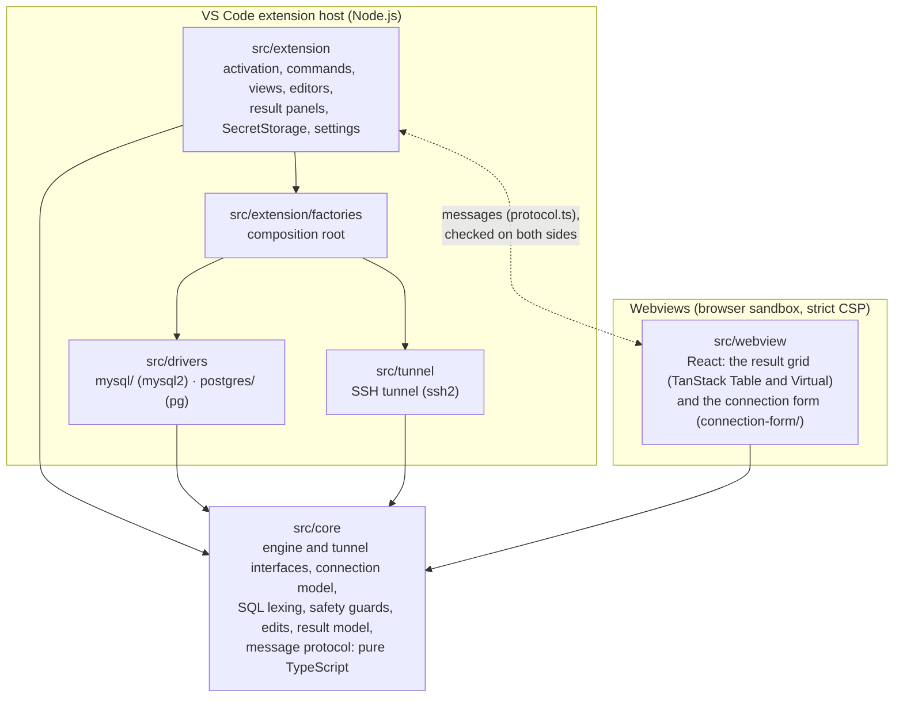
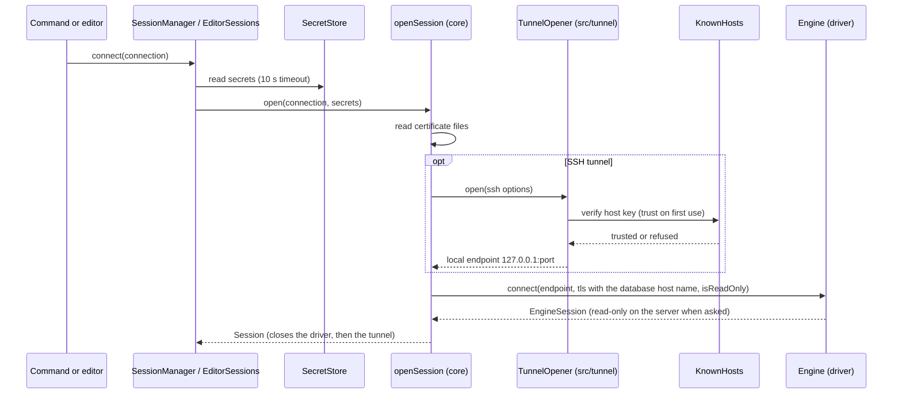
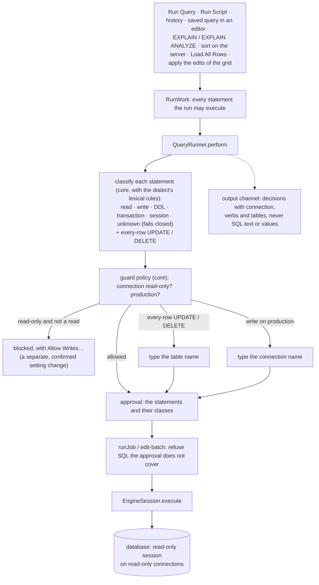
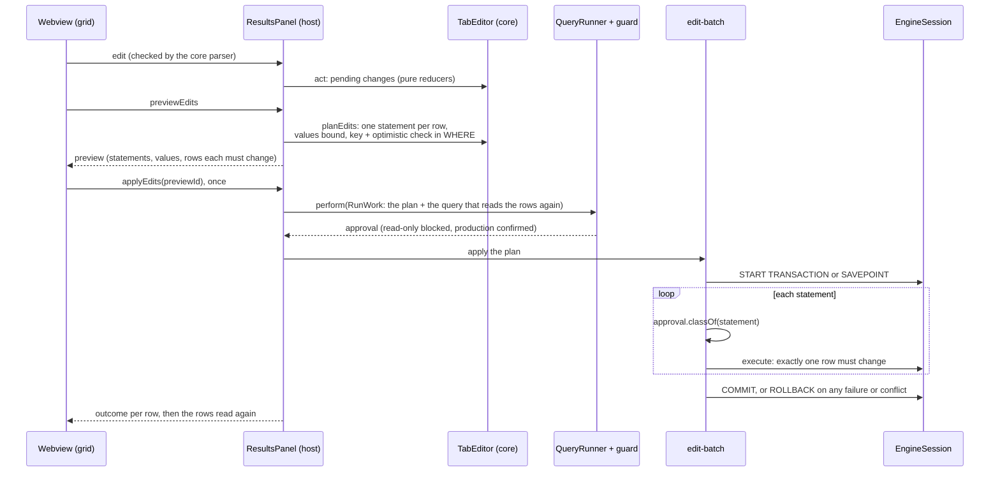
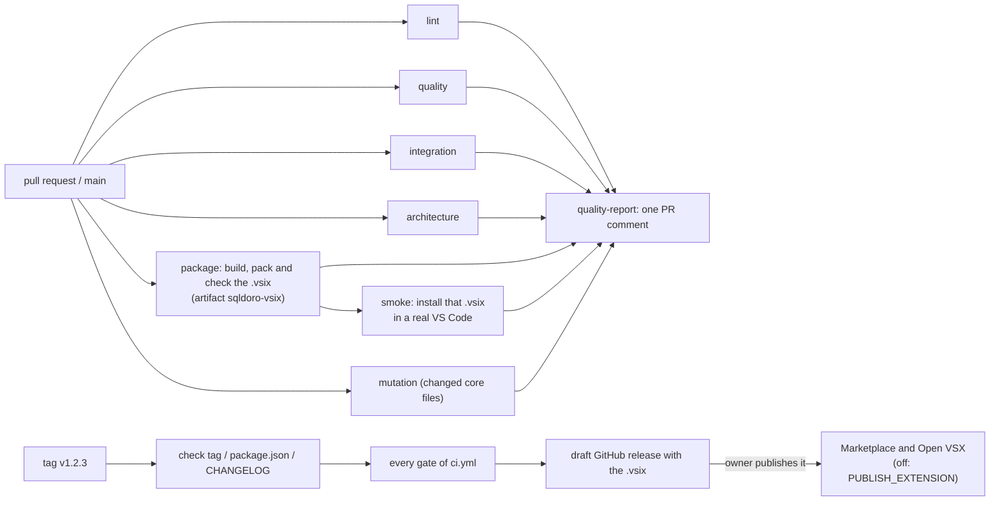

# Architecture

sqldoro is a VS Code extension in strict TypeScript, in five layers with one rule: dependencies point
inward, to the core. The rules below are not conventions only: `make lint-arch` (dependency-cruiser,
`.dependency-cruiser.mjs`) fails on an import that breaks them, `make typecheck` checks the core
without Node.js or DOM types, and `src/extension/safety/guarded-execution.test.ts` fails on any new
place that runs SQL.

## Layers

- **`src/core`** is pure TypeScript: no `vscode`, no Node.js built-ins (it also runs in the webview),
  no database, SSH or UI library. Platform services reach it through interfaces it declares (`Engine`,
  `EngineSession`, `TunnelOpener`, `Logger`, the file reader). Invariants, calculations and state
  transitions live here as pure functions: the statement classifier, the guard policy, the
  automatic `LIMIT`, the transaction state machine, what can be edited and the statements of an
  edit, the result model and the parsers of every message.
- **`src/drivers`** has one folder per database, each implementing `Engine` with its own client
  library only. Drivers never import each other, the tunnel, `vscode`, the extension host or the
  webview.
- **`src/tunnel`** implements the core tunnel interface with `ssh2` and Node.js.
- **`src/extension`** is the VS Code side. It talks to databases only through the core interfaces;
  only `src/extension/factories/` instantiates the drivers and the tunnel, so supporting another
  engine is writing its driver and registering it there (see
  [CONTRIBUTING.md](../CONTRIBUTING.md#adding-a-database-engine)).
- **`src/webview`** holds the two webviews, each a browser bundle of its own (Vite): the result grid
  and the connection form. They never import the extension host. The grid holds no rows of its own
  beyond a bounded cache: the host keeps the rows, and sorts, filters, copies and exports them.

## Opening a session

The driver dials whatever endpoint it is given: it never knows about SSH, and certificates are always
checked against the database host name, also through the tunnel. Errors are redacted of the secrets
the session was opened with before they reach the screen or the log. Each SQL editor runs on its own
session, so a long query never blocks another editor or the explorer; the explorer and the
autocomplete share one session per connection.

## The guard layer

Every statement a user or the grid runs goes through one gate. A run declares every statement it may
execute in a `RunWork`; `QueryRunner.perform` hands them to `StatementGuard`, which decides before
anything runs, and `QueryRunner.runJob` refuses any SQL the guard did not approve.

Only sqldoro's own statements bypass the guard: catalog queries, `START TRANSACTION`, `COMMIT`,
`ROLLBACK`, the savepoints of an apply and the transaction status probe. What the classifier cannot
see (procedures, triggers, user functions) is what the read-only session is for, and the permissions
of the database user remain the real guarantee.

After each statement sqldoro asks the server whether a transaction is open
(`EngineSession.transactionStatus`), so implicit commits, deadlock rollbacks and aborted
transactions show as they are. The automatic `LIMIT` is a pure rewrite in the core that appends
`LIMIT n + 1` only where that is safe, and falls back to a driver row cap elsewhere.

## Editing rows

What can be edited is decided in `src/core/edits/` from what the drivers report (the origin of each
result column, `EngineSession.describeTable`), and fails closed: joins, views, expressions and tables
without a usable key stay read-only, and the grid says why.

## The result view

The extension host runs the statements and keeps their rows (`ResultSet`, in the core). The webview
asks for windows of rows around what is in view (at most 200 at a time, a few thousand cached) and
only shows them; both rows and columns are virtualized, so a million rows or a thousand columns
scroll smoothly. Long values reach the grid cut to 1,000 characters; the detail pane asks for more and
shows up to 200,000. Every message is typed in `src/core/results/protocol.ts` and checked field by
field by the core parsers on the side that receives it. The page has a strict Content Security
Policy: one script with a nonce, styles and images from the extension only, no remote resource.

## The connection form

**Add Connection**, **Import Connection from URL** and **Edit Connection** open the connection form,
a second webview with its own bundle and the same page and policy (`src/extension/webview-page.ts`).
Its message protocol is declared in the core (`src/core/connection-form/protocol.ts`) and checked on
both sides. The form keeps its state with pure functions of the core
(`src/core/connection-form/form-state.ts`, and the changes of a connection in
`src/core/connection/transitions.ts`) and validates with the same validators as the host, which
checks the connection again before it saves. Secrets never travel to the form: it learns which kinds
are held, and what the user types reaches the host only inside a test or a save. The host writes the
secrets before the connection itself, so that a keyring that fails leaves nothing half saved, and a
new connection is tested with what was typed without asking the keyring.

## Packaging and the pipeline

See [CONTRIBUTING.md](../CONTRIBUTING.md#the-pipeline) for what each gate means and
[RELEASING.md](RELEASING.md) for releases.
