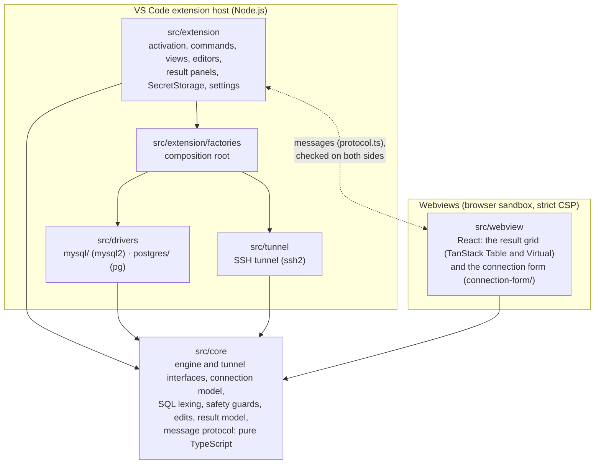
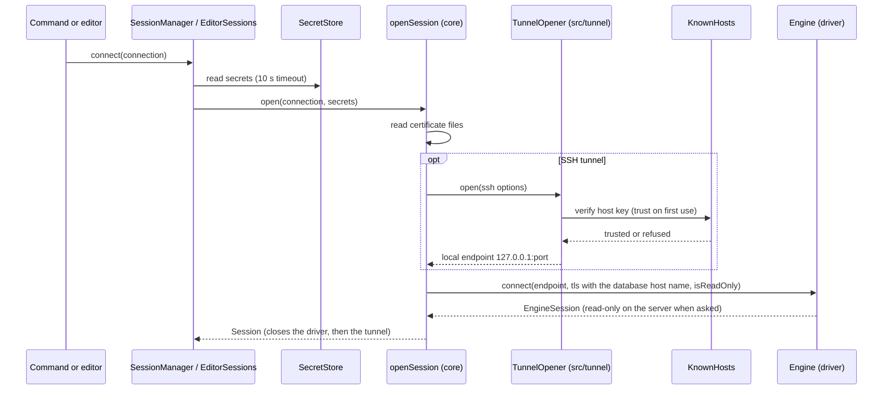
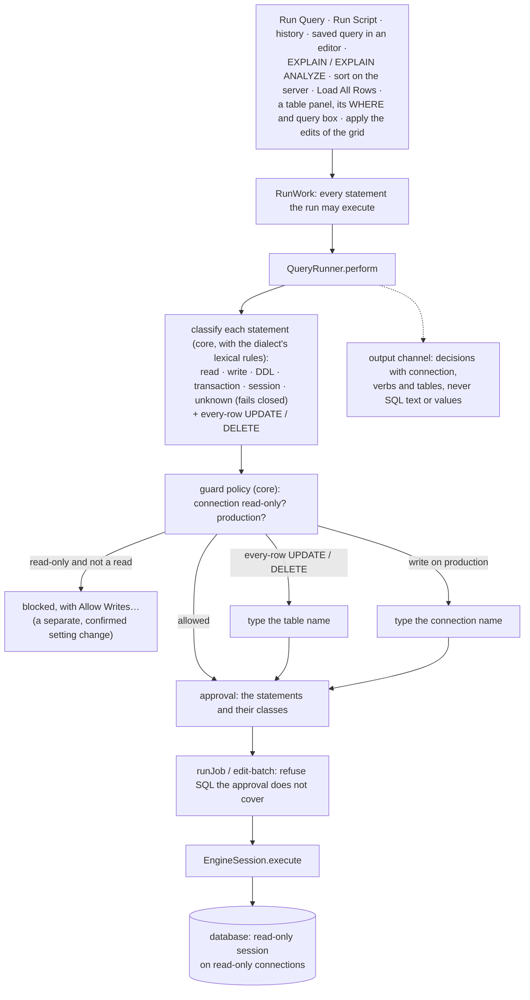
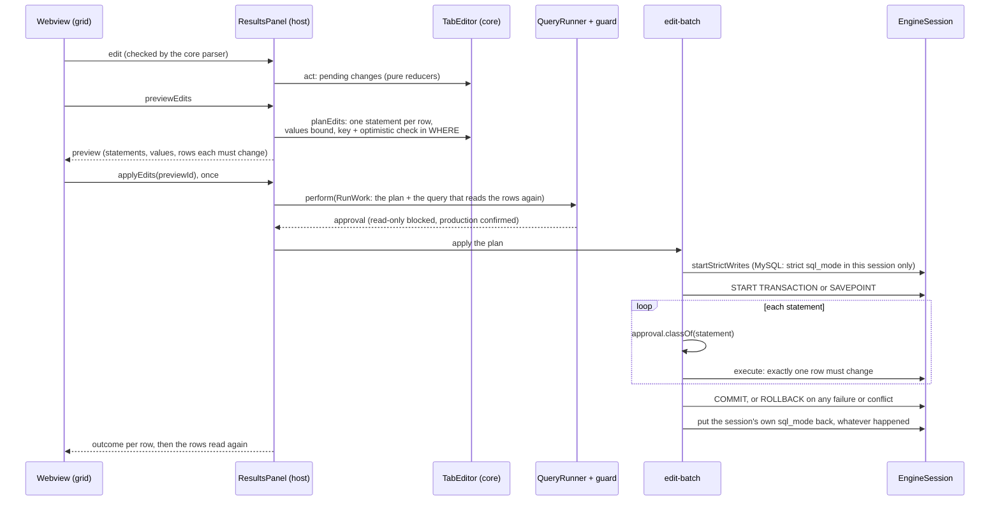
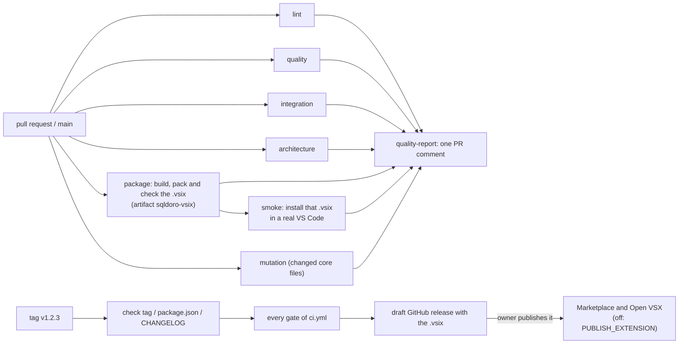

# Architecture

sqldoro is a VS Code extension in strict TypeScript, in five layers whose dependencies point inward,
to the core. `make lint-arch` (`.dependency-cruiser.mjs`) fails on an import that breaks them,
`make typecheck` checks the core without Node.js or DOM types, and
`src/extension/safety/guarded-execution.test.ts` fails on any new place that runs SQL.

## Layers

| Layer           | Holds                                                                                                                                                                                | May import                                                                    |
| --------------- | ------------------------------------------------------------------------------------------------------------------------------------------------------------------------------------ | ----------------------------------------------------------------------------- |
| `src/core`      | Interfaces (`Engine`, `EngineSession`, `TunnelOpener`, `Logger`) and pure functions: classifier, guard policy, automatic `LIMIT`, transactions, edits, result model, message parsers | nothing platform-specific (no `vscode`, Node.js, database, SSH or UI library) |
| `src/drivers`   | One folder per database implementing `Engine`                                                                                                                                        | the core and its own client library                                           |
| `src/tunnel`    | The SSH tunnel implementing the core tunnel interface                                                                                                                                | the core, `ssh2`, Node.js                                                     |
| `src/extension` | The VS Code side; only `factories/` instantiates drivers and the tunnel                                                                                                              | the core, `vscode`, Node.js; drivers only in `factories/`                     |
| `src/webview`   | The result grid and the connection form, each a Vite bundle                                                                                                                          | the core, React, TanStack                                                     |

The host and the webviews never import each other: they share the message protocol of the core and
validate every message they receive. The rows stay in the host; the grid only shows windows of them.
A new engine is a driver registered in `src/extension/factories/engines.ts` (see
[CONTRIBUTING.md](../CONTRIBUTING.md#adding-a-database-engine)).

## Opening a session

The driver dials the endpoint it is given and never knows about SSH; certificates are checked
against the database host name, also through the tunnel. Errors are redacted of the session's
secrets. Each SQL editor and each table panel has its own session; the explorer and the autocomplete
share one per connection.

## The guard layer

A run declares every statement it may execute in a `RunWork`; `QueryRunner.perform` hands them to
`StatementGuard`, which decides before anything runs, and `QueryRunner.runJob` refuses SQL the guard
did not approve.

Only sqldoro's own statements bypass the guard: catalog queries, `START TRANSACTION`, `COMMIT`,
`ROLLBACK`, the savepoints of an apply, the transaction status probe, and the `sql_mode` an apply
turns strict on MySQL and puts back after it (`EngineSession.startStrictWrites`). After each
statement sqldoro asks the server whether a transaction is open (`EngineSession.transactionStatus`).
The automatic `LIMIT` is a pure rewrite in the core (`LIMIT n + 1` where safe, a driver row cap
elsewhere).

## Editing rows

MySQL outside strict mode stores a value a column cannot hold as the nearest one it can (cut,
rounded) with only a warning. An apply turns strict mode on in the editor's own session for its
statements only, then puts the session's `sql_mode` back, even when the apply fails or is
cancelled: the server, other sessions and the user's own queries keep theirs. If it cannot put it
back, the apply's message and the log say so.

`src/core/edits/` decides what can be edited from what the drivers report (the origin of each result
column, `EngineSession.describeTable`) and fails closed: joins, views, expressions and tables without
a usable key stay read-only, and the grid says why.

## The result view

- **Rows stay in the host** (`ResultSet`). The webview asks for windows around what is in view (at
  most 200 rows at a time, a few thousand cached); rows and columns are virtualized. Values reach the
  grid cut to 1,000 characters; the detail pane asks for up to 200,000.
- **Protocol**: every message is typed in `src/core/results/protocol.ts` (`tab-editing.ts`,
  `tab-meta.ts`) and checked by the core parsers on the receiving side. The page has a strict CSP:
  one script with a nonce, no remote resource, inline SVG icons.
- **Sort, filters, quick search** are views the host computes with pure core functions
  (`applyView`, `searchRows`); the webview then asks for windows of the new order. Column filters
  (`src/core/results/conditions.ts`) compare exactly in the host (`filter-match.ts`) and become bound,
  cast conditions on the server (`filter-sql.ts`, `binders.ts`).
- **Columns**: the layout (`src/core/grid/column-layout.ts`) orders and hides columns by key; the
  webview works on the projected columns (`column-projection.ts`, `src/webview/projection.ts`) and
  translates every message back. Table panels keep their layout per table in the workspace state.
- **Loading** never blanks the view: `tabToShow` (`src/core/grid/shown-tab.ts`) keeps the last ready
  tab until the next one `isViewReady`, and `stepIndicator` (`loading-indicator.ts`, a pure state
  machine) shows a card only after 300 ms, for at least 400 ms. `prefers-reduced-motion` turns off the
  animations.
- **Host side**: `src/extension/results/results-panel.ts` keeps the tabs and posts them;
  `panel-requests.ts` and `panel-navigation-requests.ts` handle the messages.

## The explorer and finding tables

- **Loading**: the Connections view (`src/extension/tree/`) loads children when a node opens and
  caches them per connection until a refresh (`ExplorerProvider.onDidRefresh`).
- **Statistics**: with `CatalogDetail.Statistics`, `listDatabases` and `listTables` read sizes and
  estimated rows in the query that lists the objects, as text read to `bigint`; unknown is
  `undefined`, and a failing statistics query falls back to the names (logged at debug level).
- **Looks**: `NodeIcon` (`node-icons.ts`) gives each kind a codicon and a theme color; connections
  show their engine glyph, and their color reaches the label through file decorations
  (`node-uris.ts`, `ExplorerDecorations`). Databases and schemas paint their icon in that color
  (`NodeContext.tint`, resolved by `connectionTint` when the node is drawn), the database in front
  keeping its green. Folders come from `src/core/connection/folders.ts`.
- **The database in front**: `selectedScopes` and `changedScopes` (`src/core/editor/selection.ts`)
  decide which database and schema stand out; only the nodes whose mark changed are redrawn, without
  reading the catalog.
- **Find Table in Explorer** (`TableFinder`, `src/extension/commands/table-finder.ts`) filters on
  every keystroke without touching the server: `TableIndex` loads the names once through the schema
  cache, `findTables` (`src/core/table-search/found.ts`) and `matchName` (`src/core/text/fuzzy.ts`)
  match like VS Code, and `FindTree` updates only the branches `foundChanges` reports, at most once
  every 220 ms. **Go to Table…** uses the same matcher.

## Table panels

- **Source**: a table opened from the explorer is keyed by a `sqldoro-table:` URI
  (`src/extension/tables/table-uri.ts`) that finds its panel, session and transaction (always
  auto-commit). The core writes its statements (`src/core/results/table-data.ts`, and
  `table-query.ts` for a step of the trail with its key, filters and WHERE), which run through
  `QueryRunner.perform` (`table-read.ts`) like any run; these reads stay out of the history.
- **WHERE**: `tableFilterQuery` wraps the user's condition as `WHERE (<condition>` + line break +
  `)`, and refuses before running anything a condition with open strings, comments or parentheses,
  only comments, or more than one statement. The classifier sees it with the rest of the statement.
- **Query box**: shows the panel's statement (`src/core/results/query-box.ts`); its state is pure
  (`src/core/grid/query-mode.ts`). Running it checks for one statement (`boxQuery`) and goes through
  `QueryRunner.perform` like an editor (`src/extension/tables/query-box.ts`), recorded in the
  history; only then does the trail get a step. Going back and forth re-runs a step only when it
  reads (`isReadOnlyQuery`).
- **Navigation**: links come from the catalog, never the query text (`TableMetadata`,
  `src/core/navigation/links.ts`, `keys.ts`). Table panels keep a trail of steps
  (`src/core/navigation/history.ts`, `TableNavigations`). Peeks and reference counts go through
  `readThroughGuards` / `runApprovedRead`, which refuse anything that is not a read.

## The connection form

A second webview (same page and policy, `src/extension/webview-page.ts`) with its protocol in
`src/core/connection-form/protocol.ts`. Its state, problems and requests are pure core functions,
validated with the same validators the host runs again before testing, saving or listing databases.
Secrets never travel to the form: it only learns which kinds are held. Listing databases opens a
test-like session and runs a catalog query. The host writes the secrets before the connection, so a
failing keyring leaves nothing half saved.

## Packaging and the pipeline

See [CONTRIBUTING.md](../CONTRIBUTING.md#the-pipeline) for each gate and
[RELEASING.md](RELEASING.md) for releases.
